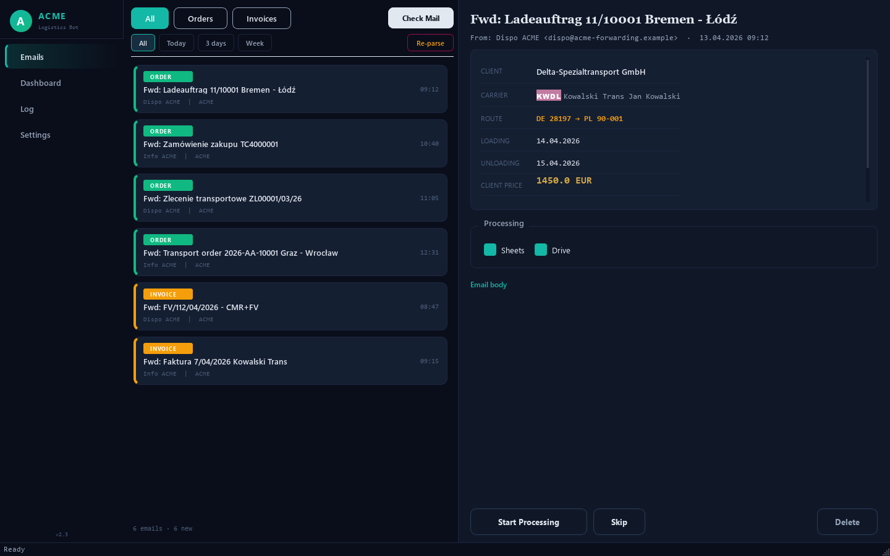
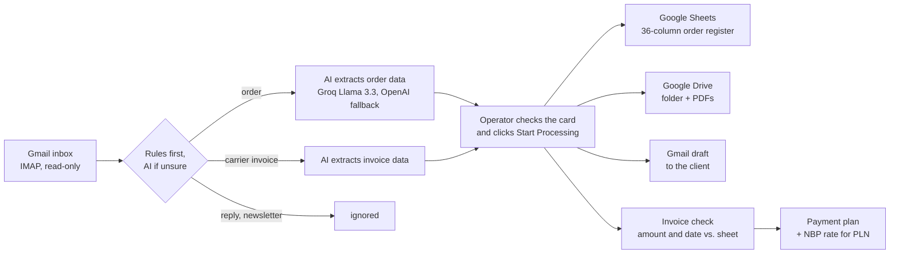
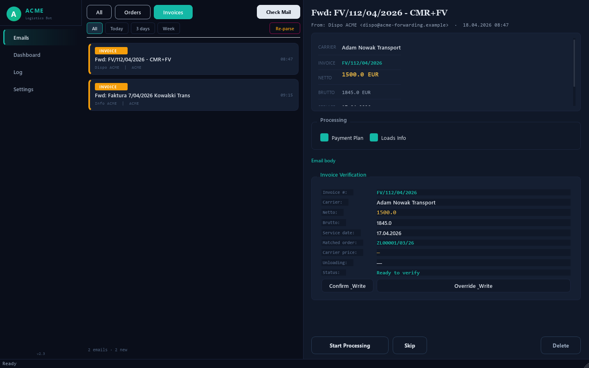

# freight-docs-automation

A desktop app for a freight forwarding office. It reads the company mailbox, finds transport
orders and carrier invoices, extracts the data with AI and fills the company's Google Sheets,
Google Drive folders and Gmail drafts.

> **Portfolio version.** I built this for a small Polish freight forwarding company.
> It was tested on real e-mails and PDFs, but it was not deployed in daily work.
> All company, client, carrier and person names, numbers and addresses in this repository are
> fictional. The real data and the tests with real documents are not published.



## The problem

In a forwarding office every transport order comes by e-mail, often as a PDF in Polish,
German or English. For each order a person:

- copies about 20 fields into a Google Sheet: client, route, dates, prices, payment terms;
- creates a Drive folder for the documents;
- later checks the carrier's invoice against the order: net amount and service date;
- adds the invoice to a payment plan, and converts PLN to EUR with the NBP rate;
- sends the client an e-mail with our invoice and the delivery documents (POD).

With 12–20 orders a day this is a lot of copy-paste, and one wrong digit costs money.

## How it works



The app never sends e-mails by itself. It creates drafts, and a person checks every card
before anything is written.



## Features

**Reading mail** (`mail_reader.py`)
- IMAP in read-only mode: e-mails are never moved, deleted or flagged.
- Only e-mails from the company's own addresses (orders are forwarded there), last 45 days.
- Two steps: headers first, the full e-mail only if it is new. Our own outgoing e-mails are skipped.

**Classification** (`ai_parser.classify_email`)
- Simple rules first: subject keywords in PL/DE/EN, reply prefixes, carrier code in the first line.
- AI only when the rules cannot decide, with a few examples in the prompt.

**Data extraction** (`ai_parser.parse_order`, `parse_invoice`)
- AI prompt with business rules: who is the client and who is the carrier, places as
  `country + postal code`, routes with several stops, full order numbers.
- One broker always sends the same PDF layout, so it is parsed with regular expressions,
  not AI.
- Scanned PDFs: OCR fallback. After AI, postal codes and dates are cleaned and checked.

**Order register in Google Sheets** (`actions.write_to_loads_info`)
- One row per order, 36 columns (A–AJ): client, route, dates, carrier, net/VAT/gross,
  margin, payment terms and payment dates. Totals are sheet formulas, not fixed numbers.
- VAT 23% for Polish clients (PL tax number, Polish company form or price in PLN),
  0 for clients with a VAT number from another EU country.
- Carrier payment terms from a carrier table. For our own trucks and some carriers
  the terms follow the client's terms.
- Duplicate check: an order number that is already in the sheet is not added again (`loads_cache.py`).

**Carrier invoices** (`actions.verify_invoice`, `write_to_payment_plan`)
- Compares the invoice with the order row: net amount and unloading date.
  Differences are shown to the operator.
- Writes the invoice to the payment plan.
- PLN amounts (client price or carrier invoice) are converted to EUR. The rate and the
  NBP table number are written as a note in the cell.

**NBP exchange rate** (`nbp_rates.py`)
- EUR/PLN mid rate from the public NBP API for the last business day before the unloading
  date (the rule used in Polish VAT, art. 31a).
- Weekends and holidays are skipped, rates are cached. If the date is in the future,
  the row is marked as an approximate rate.

**Our invoices to clients** (`invoice_checker.py`, `email_templates.py`)
- Watches a folder with our sales invoices (PDF), reads the number and amounts,
  finds the order and writes the invoice number to the sheet.
- Builds the e-mail to the client: standard (Polish or English), with skonto discount,
  or one batch e-mail for a broker that wants many invoices together.

**CMR documents** (`cmr_watcher.py`)
- A CMR scan named with the order number is attached to the right Gmail draft.

**Experimental, not connected to the main window**
- `cmr_processor.py`: CMR photo → GPT vision → finds the order by plates and route.
- `telegram_cmr.py`: drivers send CMR photos to a Telegram bot.
- `saldeo_client.py`: SaldeoSMART API client (create a sales invoice, get the PDF, contractors).

## Tech stack

| Area | Tools |
|---|---|
| Language, UI | Python 3, PyQt6 |
| AI | Groq API (Llama 3.3 70B), OpenAI (fallback, vision for CMR) |
| PDF | pdfplumber, PyMuPDF, pypdf, OCR fallback (Tesseract) |
| Google | Sheets API (gspread), Drive API, Gmail API (drafts), OAuth 2.0 |
| Mail | IMAP (imaplib) |
| Other | NBP public API, SaldeoSMART API, Telegram Bot API |

## Project structure

| File | What it does |
|---|---|
| `main.py`, `app.py` | Start the app; PyQt6 window with Emails, Dashboard, Log, Settings |
| `mail_reader.py` | Reads Gmail over IMAP and saves new e-mails |
| `ai_parser.py` | Classifies e-mails and extracts order/invoice data |
| `executor.py`, `task.py` | Background task queue for processing |
| `actions.py` | Google Sheets, Drive and Gmail actions, invoice check, payment plan |
| `loads_cache.py` | Cache of order numbers for duplicate check |
| `nbp_rates.py` | NBP exchange rates |
| `invoice_checker.py`, `email_templates.py` | Our invoices and e-mails to clients |
| `cmr_watcher.py` | Attaches CMR files to drafts |
| `cmr_processor.py`, `telegram_cmr.py`, `saldeo_client.py` | Experimental modules |
| `config.py` | Settings from `.env` and the carrier table |
| `demo/` | Fictional e-mails and a script that makes the screenshots |

## Run the demo

The demo opens the real window with fictional e-mails. It does not connect to mail,
Google or AI.

```
python -m venv .venv
.venv\Scripts\pip install -r requirements.txt
.venv\Scripts\python demo\screenshot.py
```

The screenshots are saved to `docs/`. To run the full app you need a Google Cloud project
with OAuth credentials (`credentials.json`), and the keys from `.env.example` in a `.env` file.

## Status and limits

- Prototype, tested on real e-mails and PDFs, not used in daily work.
  A regression script with about 100 checks (carrier codes, payment terms, parsing) is not
  published, because it uses real documents.
- Single user, Windows, Gmail only. Some rules (carrier codes, client templates) belong to
  the original company and would need to be changed for another one.
- AI can read a document wrong, so every result is checked by a person before it is written.
- The code was written with AI coding assistants. The process, the business rules and the
  data structure come from my own work in a freight forwarding office.

Author: Yurii Savaryn
